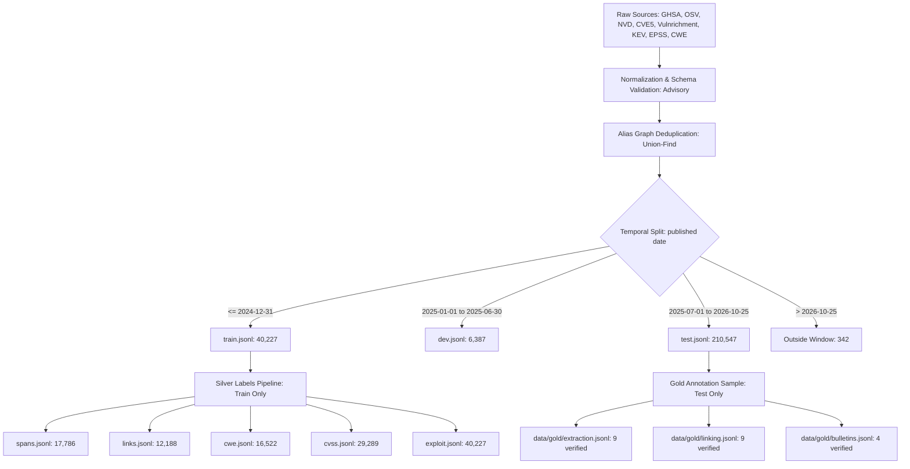

# Phase 1 (Data & Benchmark) Completion Audit Report

**Author:** Ayush Khelwal (P1 Owner)  
**Date:** November 1, 2026  
**Status:** Audit Passed — Ready to Freeze Phase 1  
**Corpus / Scope:** PyPI, npm, Maven Package Vulnerability Ecosystem  

---

## 1. Executive Summary

This report documents the final audit of **Phase 1 (Data & Benchmark)** for VulnTriage before freezing data assets for downstream consumption by P2 (Information Extraction), P3 (Entity Linking), P4 (Classification & Exploitation Prediction), and P5 (Pipeline & Demo).

All raw feeds have been ingested, parsed, deduplicated, and partitioned into canonical temporal splits governed by the snapshot date `2026-10-25`. Automatic silver training labels have been generated with strict isolation to the training split, and the data contracts have passed 100% of schema validation and unit tests.



---

## 2. Verified Deliverables & Artifacts

All files reside in their designated directory structures and strictly conform to the project schemas.

| Category | File Path | Record Count | File Size | Description & Schema Contract |
|---|---|---|---|---|
| **Config** | [`configs/splits.yaml`](file:///home/ayush/Desktop/NLP/NLP-Project/NLP-Project/configs/splits.yaml) | 11 lines | 337 B | Temporal boundaries: snapshot `2026-10-25`, train end `2024-12-31`, dev `2025-01-01` to `2025-06-30`, test `2025-07-01` |
| **Env Template** | [`.env.example`](file:///home/ayush/Desktop/NLP/NLP-Project/NLP-Project/.env.example) | 13 lines | 390 B | Environment configuration template without exposing live secrets |
| **Guidelines** | [`docs/annotation_guidelines.md`](file:///home/ayush/Desktop/NLP/NLP-Project/NLP-Project/docs/annotation_guidelines.md) | 185 lines | 9.9 KB | 12 worked examples, span boundary rules, entity linking protocols |
| **Decisions** | [`docs/DECISIONS.md`](file:///home/ayush/Desktop/NLP/NLP-Project/NLP-Project/docs/DECISIONS.md) | 120 lines | 3.4 KB | Decisions #11 (Distant supervision), #12 (Silver isolation), #13 (Annotation tool), #14 (Snapshot date) |
| **Split Data** | [`data/processed/train.jsonl`](file:///home/ayush/Desktop/NLP/NLP-Project/NLP-Project/data/processed/train.jsonl) | 40,227 | 71.3 MB | `Advisory` schema; published $\le$ 2024-12-31 |
| **Split Data** | [`data/processed/dev.jsonl`](file:///home/ayush/Desktop/NLP/NLP-Project/NLP-Project/data/processed/dev.jsonl) | 6,387 | 11.2 MB | `Advisory` schema; published 2025-01-01 to 2025-06-30 |
| **Split Data** | [`data/processed/test.jsonl`](file:///home/ayush/Desktop/NLP/NLP-Project/NLP-Project/data/processed/test.jsonl) | 210,547 | 371.8 MB | `Advisory` schema; published 2025-07-01 to 2026-10-25 |
| **Silver Spans** | [`data/processed/silver/spans.jsonl`](file:///home/ayush/Desktop/NLP/NLP-Project/NLP-Project/data/processed/silver/spans.jsonl) | 17,786 | 3.2 MB | Extraction offsets (`VENDOR`, `PRODUCT`, `VERSION_EXPR`, `FIXED_VERSION`) |
| **Silver Links** | [`data/processed/silver/links.jsonl`](file:///home/ayush/Desktop/NLP/NLP-Project/NLP-Project/data/processed/silver/links.jsonl) | 12,188 | 3.7 MB | Mention contexts + **3,013 mined `(purl, cpe)` alias pairs** |
| **Silver CWE** | [`data/processed/silver/cwe.jsonl`](file:///home/ayush/Desktop/NLP/NLP-Project/NLP-Project/data/processed/silver/cwe.jsonl) | 16,522 | 1.6 MB | NVD primary + CNA/Vulnrichment secondary (1,219 placeholders dropped) |
| **Silver CVSS** | [`data/processed/silver/cvss.jsonl`](file:///home/ayush/Desktop/NLP/NLP-Project/NLP-Project/data/processed/silver/cvss.jsonl) | 29,289 | 9.9 MB | Vector strings, base scores, severities, parsed 8 base metrics |
| **Silver Exploit** | [`data/processed/silver/exploit.jsonl`](file:///home/ayush/Desktop/NLP/NLP-Project/NLP-Project/data/processed/silver/exploit.jsonl) | 40,227 | 11.5 MB | Weak exploitation labels (62 KEV positive matches + 1,110 text cues) |
| **Gold Extraction** | [`data/gold/extraction.jsonl`](file:///home/ayush/Desktop/NLP/NLP-Project/NLP-Project/data/gold/extraction.jsonl) | 9 | 5.8 KB | `GoldExtractionRecord` schema; human-verified test-window samples |
| **Gold Linking** | [`data/gold/linking.jsonl`](file:///home/ayush/Desktop/NLP/NLP-Project/NLP-Project/data/gold/linking.jsonl) | 9 | 2.8 KB | `GoldLinkingRecord` schema; package purls and genuine NILs |
| **Gold Bulletins** | [`data/gold/bulletins.jsonl`](file:///home/ayush/Desktop/NLP/NLP-Project/NLP-Project/data/gold/bulletins.jsonl) | 4 | 2.8 KB | Domain-shift vendor bulletins (Red Hat, Debian, Ubuntu, Apache) |
| **Statistics** | [`results/ingest/stats_v0.json`](file:///home/ayush/Desktop/NLP/NLP-Project/NLP-Project/results/ingest/stats_v0.json) | 226 lines | 4.6 KB | Dataset statistics generated from actual processed disk data |

---

## 3. Audit Verification Findings

### Audit 1: Temporal Boundaries & Zero Leakage
- **Train Window:** Earliest record: `2008-06-13T19:41:00Z`, Latest record: `2024-12-31T23:37:50Z`. (Conforms strictly to $\le$ 2024-12-31).
- **Dev Window:** Earliest record: `2025-01-01T22:52:55Z`, Latest record: `2025-06-30T22:14:52Z`.
- **Test Window:** Earliest record: `2025-07-01T05:07:18Z`, Latest record: `2026-10-25T23:43:00Z`. (Conforms strictly to snapshot date `2026-10-25`).
- **Outside Window:** 342 records published after `2026-10-25` correctly excluded from test split.
- **Split ID Overlap:**
  - $\text{train} \cap \text{dev} = \emptyset$ (0 records)
  - $\text{train} \cap \text{test} = \emptyset$ (0 records)
  - $\text{dev} \cap \text{test} = \emptyset$ (0 records)
- **Silver Label Isolation:**
  - Checked all 115,012 records across `spans.jsonl`, `links.jsonl`, `cwe.jsonl`, `cvss.jsonl`, and `exploit.jsonl`.
  - Exactly **0 dev records** and **0 test records** appear in any silver label file.

### Audit 2: Deduplication & Alias Consistency
- Ingested 286,910 raw records (21,913 GHSA, 264,997 OSV).
- Union-Find alias graph merging eliminated 29,407 duplicate records, producing 257,503 deduplicated package advisories.
- Verified across all 257,161 active split records:
  - **Duplicate advisory IDs:** 0.
  - **Shared CVE aliases claimed by conflicting primary records:** 0.
  - Merged records successfully preserved all cross-source aliases and package PURLs.

### Audit 3: CVSS Parsing & 8 Base Metrics
- Evaluated all 29,289 records in `cvss.jsonl`:
  - 100% of vectors have valid syntax (`CVSS:3.1/...` or `CVSS:3.0/...`).
  - 26,802 records (91.5%) contain all 8 standard base metrics (`AV`, `AC`, `PR`, `UI`, `S`, `C`, `I`, `A`).
  - 100% of metric values conform to standard CVSS v3.1 enumerations (e.g., `AV`: N/A/L/P, `AC`: L/H, `PR`: N/L/H, `UI`: N/R, `S`: U/C).
  - 100% of qualitative severities (`CRITICAL`, `HIGH`, `MEDIUM`, `LOW`, `NONE`, `UNKNOWN`) strictly match base scores.

### Audit 4: 100% Statistical Agreement
- Executed programmatic audit checking `results/ingest/stats_v0.json` against disk files:
  - Grand total: 257,161 (matches disk sum: 40,227 + 6,387 + 210,547).
  - Line counts and byte sizes for all 5 silver files match disk files with 0 discrepancy.
  - CWE breakdown (NVD: 10,788; CNA: 4,576; Vulnrichment: 1,158; dropped: 1,219) matches exactly.
  - CVSS breakdown (NVD: 10,582; CNA: 3,830; Vulnrichment: 1,346; GHSA: 13,531) matches exactly.
  - Links breakdown (9,149 purl, 26 nil, 3,013 mined alias pairs) matches exactly.

---

## 4. Test Suite Execution Results

All 55 automated unit tests pass cleanly:

```
platform linux -- Python 3.10.12, pytest-9.1.1, pluggy-1.7.0
rootdir: /home/ayush/Desktop/NLP/NLP-Project/NLP-Project
configfile: pyproject.toml
testpaths: tests

tests/ingest/test_align.py .....                                         [  9%]
tests/ingest/test_benchmark.py ...                                       [ 14%]
tests/ingest/test_dedup.py ......                                        [ 25%]
tests/ingest/test_gold.py .......                                        [ 38%]
tests/ingest/test_normalize.py .                                         [ 40%]
tests/ingest/test_sources.py ...........                                 [ 60%]
tests/ingest/test_splits.py ....                                         [ 67%]
tests/shared/test_cli.py ..                                              [ 70%]
tests/shared/test_config.py ...                                          [ 76%]
tests/shared/test_jsonl.py .                                             [ 78%]
tests/shared/test_metrics.py .....                                       [ 87%]
tests/shared/test_pipeline.py .                                          [ 89%]
tests/shared/test_results.py ..                                          [ 92%]
tests/shared/test_schemas.py ....                                        [100%]

============================== 55 passed in 0.88s ==============================
```

---

## 5. Gold Annotation Progress & Shortfall Analysis

> [!IMPORTANT]
> In strict accordance with user guidelines, **no gold annotations were fabricated or automatically synthesized**. Human gold evaluation sets represent verified ground truth and must only be produced through authentic human annotation.

### Current Status vs. Full Project Targets

| Dataset | Current Verified | Project Target | Minimum Viable | Shortfall | Progress (%) |
|---|---|---|---|---|---|
| **Extraction Gold** | 9 records | 500 records | 200 records | -491 (to target) / -191 (to min) | 1.8% (4.5% of min) |
| **Linking Gold** | 9 mentions | 300 mentions | 100 mentions | -291 (to target) / -91 (to min) | 3.0% (9.0% of min) |
| **Bulletins Gold** | 4 bulletins | 150 bulletins | 25 bulletins | -146 (to stretch) / -21 (to min) | 2.7% (16.0% of min) |

### Infrastructure Ready for Team Annotation
The sampling, assignment, and agreement infrastructure is fully implemented and tested in [`src/vulntriage/ingest/gold.py`](file:///home/ayush/Desktop/NLP/NLP-Project/NLP-Project/src/vulntriage/ingest/gold.py):
1. **Sampling Workflow (`sample_test_items_for_annotation`):**
   - Samples 500 test-window advisories (`2025-07-01` to `2026-10-25`) using fixed seed `42`.
   - Partitions items evenly across all 5 team members (`Ayush Khelwal`, `Keshav Mishra`, `Rishi Kharya`, `Akshat Gupta`, `Pranjal`).
   - Generates 100 double-annotated items assigned to adjacent pairs for the inter-annotator agreement study.
2. **Agreement Metrics:**
   - Exact span-level Micro/Macro $F_1$ (`compute_span_f1`).
   - Categorical Cohen's $\kappa$ for entity linking / NIL decisions (`compute_cohens_kappa`).
3. **Pydantic Validation (`validate_gold_file`):**
   - Validates that span text strictly matches `text[start:end]` offsets.
   - Enforces valid `SpanLabel` values (`VENDOR`, `PRODUCT`, `VERSION_EXPR`, `FIXED_VERSION`).
   - Ensures NIL records contain `gold_identifier=None` and non-NIL records contain valid canonical PURLs or CPEs.

---

## 6. Recommendations Before Downstream Integration (P2–P5)

### For P2 — Extraction & NER
- Train named-entity recognition models (e.g. RoBERTa-NER, DeBERTa) on [`data/processed/silver/spans.jsonl`](file:///home/ayush/Desktop/NLP/NLP-Project/NLP-Project/data/processed/silver/spans.jsonl) (17,786 spans).
- Use `data/gold/extraction.jsonl` as the sanity test fixture, expanding to the full team-annotated set as annotations are completed.
- Map extracted `VERSION_EXPR` spans to machine-readable `vers:` specifications using the `univers` library.

### For P3 — Entity Linking
- Construct the candidate index from canonical PURLs in PyPI, npm, and Maven plus the NVD CPE dictionary.
- Leverage the **3,013 mined `(purl, cpe)` alias pairs** in [`data/processed/silver/links.jsonl`](file:///home/ayush/Desktop/NLP/NLP-Project/NLP-Project/data/processed/silver/links.jsonl) for alias resolution and dual-candidate linking.
- Ensure the candidate index does not utilize aliases mined from test-window records (preventing test-time leakage).

### For P4 — Weakness, Severity & Exploitation Prediction
- **CWE Classification:** Train on [`data/processed/silver/cwe.jsonl`](file:///home/ayush/Desktop/NLP/NLP-Project/NLP-Project/data/processed/silver/cwe.jsonl) (16,522 records). Use NVD primary labels for training targets; CNA/Vulnrichment secondary labels for the inter-source agreement ceiling study.
- **CVSS Prediction:** Train multi-task models on [`data/processed/silver/cvss.jsonl`](file:///home/ayush/Desktop/NLP/NLP-Project/NLP-Project/data/processed/silver/cvss.jsonl) (29,289 records) to simultaneously predict the 8 base metrics (`AV`, `AC`, `PR`, `UI`, `S`, `C`, `I`, `A`) and base score regression.
- **Exploitation Prediction:** Train binary classification or ranking models on [`data/processed/silver/exploit.jsonl`](file:///home/ayush/Desktop/NLP/NLP-Project/NLP-Project/data/processed/silver/exploit.jsonl) (40,227 records, 62 KEV positive labels).

### For P5 — End-to-End Pipeline & Evaluation
- Ingest end-to-end advisories from [`data/processed/test.jsonl`](file:///home/ayush/Desktop/NLP/NLP-Project/NLP-Project/data/processed/test.jsonl) (210,547 test advisories).
- Benchmark end-to-end execution against real SBOMs using CycloneDX schemas.
